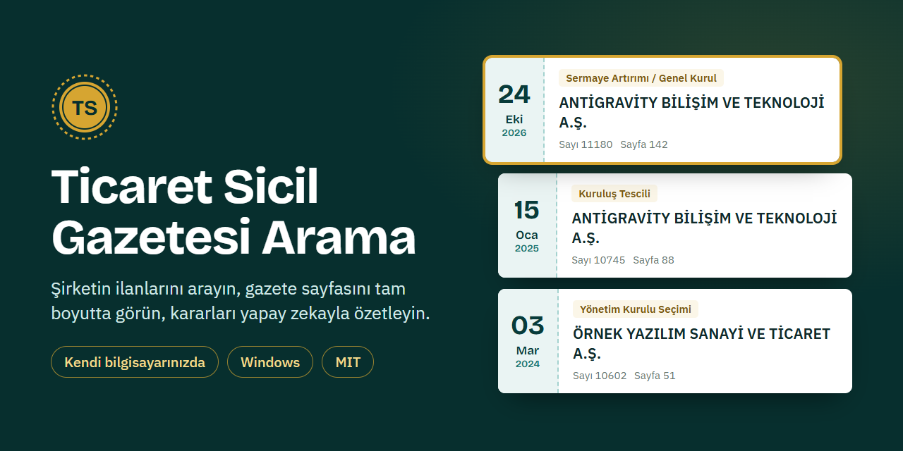
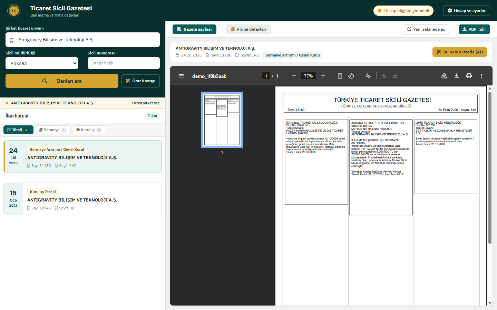
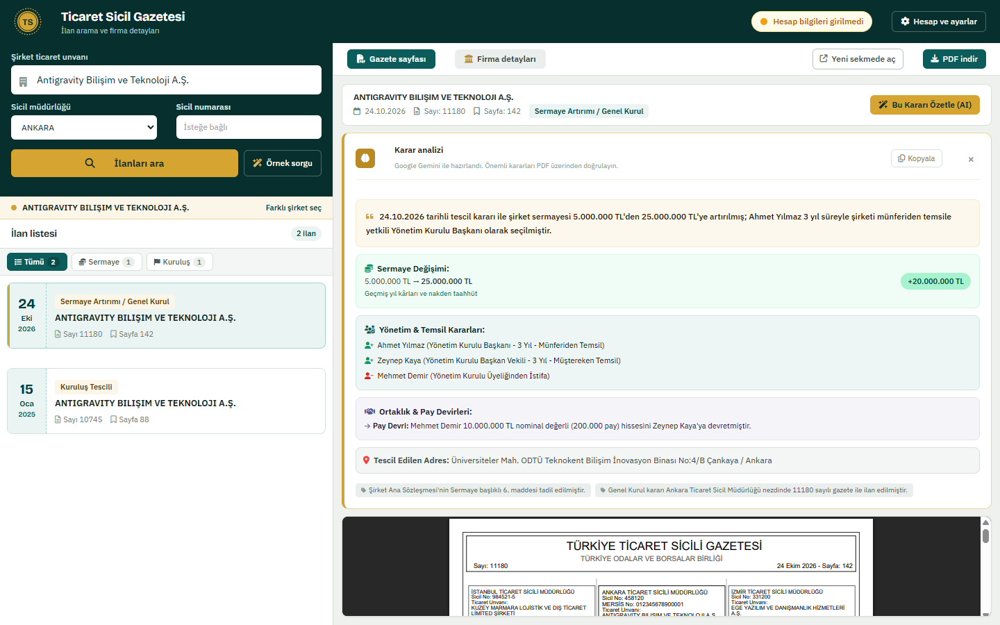
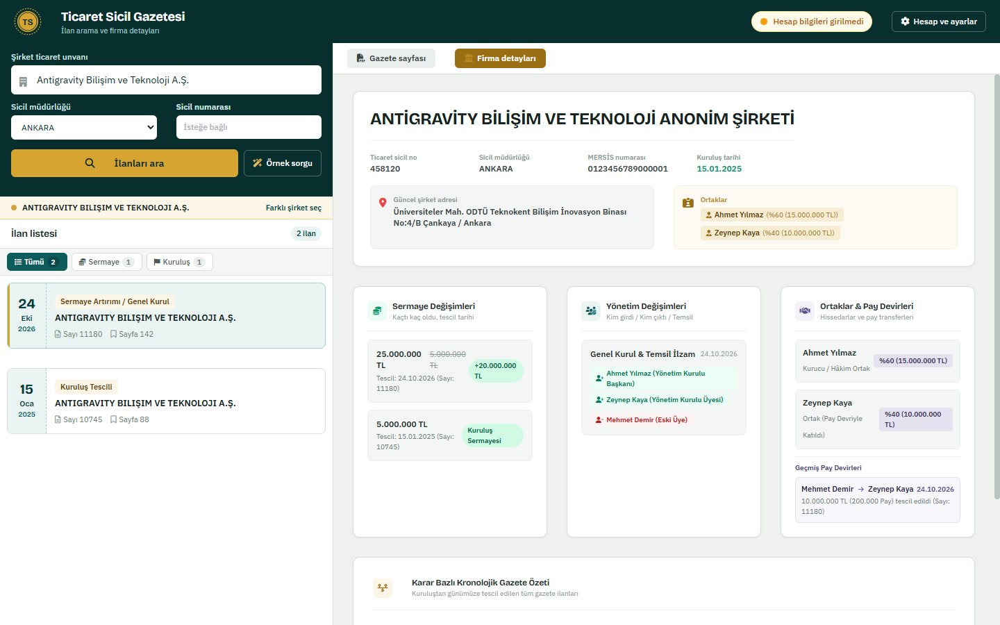
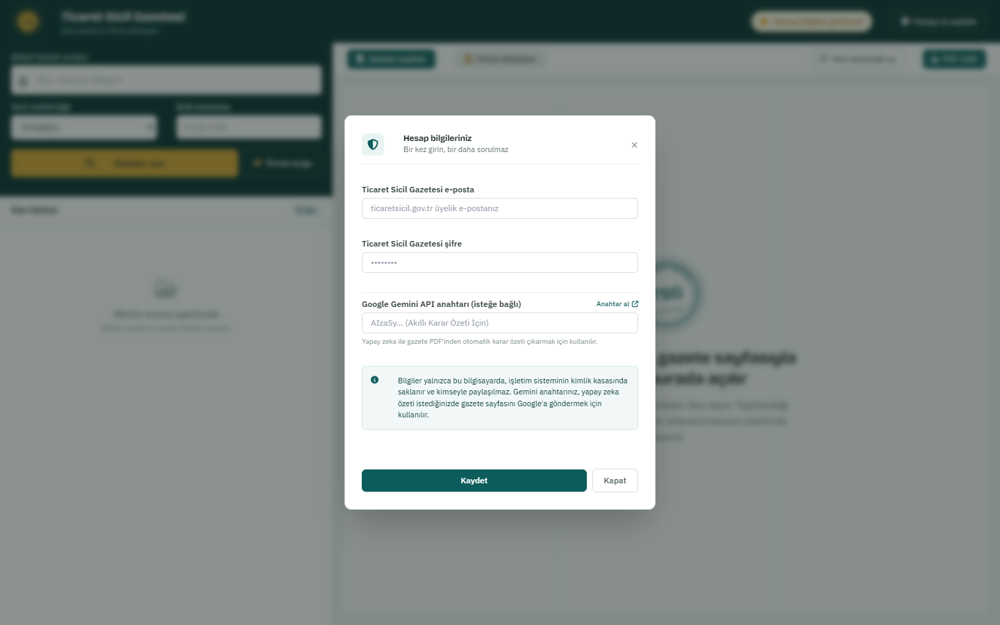

<div align="center">



# Ticaret Sicil Gazetesi Arama

**Şirketin ilanlarını arayın. Gazete sayfasını tam boyutta görün. Kararları yapay zekayla özetleyin.**
Hepsi kendi bilgisayarınızda, kendi hesabınızla.

[](LICENSE)
[](https://www.python.org/downloads/)
[](#kurulum-windows)
[](https://github.com/Galathilion84/TicaretSicilAnaliz/actions/workflows/ci.yml)

[Kurulum](#kurulum-windows) · [Özellikler](#özellikler) · [Gizlilik](#gizlilik-ve-veri-akışı) · [Sorun giderme](#sorun-giderme) · [English](#english)

</div>

---

> [!WARNING]
> **Resmî bir TSG uygulaması değildir** ve Türkiye Ticaret Sicil Gazetesi ile ilişkisi yoktur.
> Uygulama sizin hesabınızla giriş yapar ve giriş ekranındaki güvenlik kodunu (CAPTCHA) otomatik çözer.
> **Kullanım şartlarına uygunluk size aittir**, hesabınızın kısıtlanabileceğini göz önünde bulundurun. Toplu/otomatik tarama için kullanmayın.
> Yapay zeka özetleri hata yapabilir; önemli kararları her zaman gazete sayfasından doğrulayın.

## Neden?

Bir şirketin geçmişini (kuruluş, sermaye artırımları, yönetim kurulu değişiklikleri, ortaklar, adres) öğrenmek için onlarca gazete
ilanını tek tek açıp okumanız gerekir. Bu uygulama ilanları listeler, ilgili gazete sayfasını açar ve isterseniz Google Gemini ile
okunabilir bir özet çıkarır.

<table>
  <tr>
    <td width="50%"><br><sub><b>İlanlar ve gazete sayfası.</b> Listeden seçin, yayınlandığı sayfa sağda tam boyutta açılır.</sub></td>
    <td width="50%"><br><sub><b>Karar özeti.</b> Sermaye, yönetim, ortaklık ve adres değişiklikleri tek bakışta.</sub></td>
  </tr>
  <tr>
    <td width="50%"><br><sub><b>Firma detayları.</b> Şirketin künyesi ve geçmişi ilanlardan derlenir.</sub></td>
    <td width="50%"><br><sub><b>Bir kez giriş.</b> Bilgileriniz yalnızca bilgisayarınızın kimlik kasasında saklanır.</sub></td>
  </tr>
</table>

<sub>Ekran görüntüleri uygulamadaki **örnek sorgu** modunun kurgusal verileriyle alınmıştır.</sub>

## Özellikler

| | |
|---|---|
| **İlan arama** | Unvan, sicil müdürlüğü ve sicil numarasıyla arama. Birden çok şirket çıkarsa seçim penceresi |
| **Tam sayfa gazete** | İlanın yayınlandığı gazete sayfası PDF olarak önizlenir ve indirilir. Sayfalar diskte önbelleğe alınır |
| **Karar özeti (AI)** | Seçili ilanın kararını Gemini ile özetler: sermaye değişimi, atamalar, pay devirleri, adres |
| **Firma detayları** | Kuruluş, güncel adres, MERSİS, ortaklar, sermaye geçmişi ve yönetim değişiklikleri |
| **Bir kez giriş** | TSG hesabı ve Gemini anahtarı işletim sisteminin kimlik kasasında (Windows Kimlik Bilgisi Yöneticisi) saklanır |
| **Otomatik güvenlik kodu** | Giriş ve gazete görüntüleme sırasındaki CAPTCHA yerel OCR ile çözülür |
| **Kurumsal ağ desteği** | Proxy/PAC algılama ve kurum SSL denetimi (işletim sistemi sertifika deposu) |
| **Örnek sorgu** | Hesap girmeden arayüzü kurgusal verilerle deneyin |

## Kurulum (Windows)

1. **Python 3.12** kurun: <https://www.python.org/downloads/> (kurulumda **"Add python.exe to PATH"** kutusunu işaretleyin).
2. Bu sayfada **Code → Download ZIP** ile indirip bir klasöre çıkarın.
3. **`Baslat.bat`** dosyasına çift tıklayın.

İlk çalıştırmada gerekli paketler kurulur (internet gerekir, birkaç dakika sürebilir), sonra tarayıcınız
`http://localhost:8000` adresinde açılır. İlk açılışta **Hesap ve ayarlar** penceresi kendiliğinden gelir:

- **Ticaret Sicil Gazetesi e-posta ve şifreniz** (ticaretsicil.gov.tr üyeliği; yoksa sitesinden ücretsiz oluşturabilirsiniz)
- **Google Gemini API anahtarınız** (isteğe bağlı, yalnızca yapay zeka özeti için): <https://aistudio.google.com/app/apikey>

Bilgiler **bir kez** girilir, sonraki açılışlarda sorulmaz. Kapatmak için `Baslat.bat` penceresinde `Ctrl+C`.
macOS/Linux: `baslat.sh` bulunur ama **denenmemiştir**.

## Gizlilik ve veri akışı

Hiçbir veri geliştiriciye ya da bir sunucuya gönderilmez. Uygulama yalnızca iki yere bağlanır:

| Nereye | Ne zaman | Ne gider |
|---|---|---|
| `ticaretsicil.gov.tr` | Arama ve gazete görüntüleme | Sizin hesabınızla giriş, arama sorgusu |
| Google Gemini API | Yalnızca **özet istediğinizde** | İlgili **gazete sayfası** (PDF), sizin API anahtarınızla |

Uygulama yalnızca bu bilgisayardan erişilebilir (`127.0.0.1`). Kötü niyetli bir web sitesinin onu hedeflememesi için yabancı `Host`
ve farklı kaynaklı `Origin` istekleri reddedilir. Ayrıntılar: [SECURITY.md](SECURITY.md).
**Uygulamayı internete ya da yerel ağa açmayın**, kullanıcı hesabı yoktur.

## Sık sorulan sorular

<details><summary><b>Bilgilerim nerede saklanıyor?</b></summary>

Windows Kimlik Bilgisi Yöneticisi'nde (adında `ticaretsicil-yerel` geçen kayıtlar). Silmek için Denetim Masası → Kimlik Bilgisi Yöneticisi →
Windows Kimlik Bilgileri altından kayıtları kaldırın. Kimlik kasası yoksa bilgiler proje klasöründeki `.env` dosyasına yazılır ve uygulama bunu belirtir.
</details>

<details><summary><b>Gemini anahtarı olmadan çalışır mı?</b></summary>

Evet. Arama, gazete sayfası ve firma detaylarının yerel (OCR ile) bölümü anahtar olmadan da çalışır. Yalnızca yapay zeka özeti anahtar ister.
</details>

<details><summary><b>Verilerim Google'a gidiyor mu?</b></summary>

Yalnızca siz bir ilan için **özet istediğinizde** ve o ilanın gazete sayfası, sizin API anahtarınızla Gemini'ye gönderilir. Gemini'nin
veriyi nasıl işlediği anahtarınızın türüne (ücretsiz/ücretli) ve Google'ın koşullarına bağlıdır.
</details>

<details><summary><b>Birden çok kişi aynı anda kullanabilir mi?</b></summary>

Bu sürüm tek kişilik, kendi bilgisayarınız içindir. Herkes kendi kopyasını kendi hesabıyla çalıştırır.
</details>

## Sorun giderme

| Belirti | Çözüm |
|---|---|
| `Python bulunamadı` | Python 3.12'yi kurun, **PATH** kutusunu işaretleyin ve `Baslat.bat`'ı yeniden çalıştırın |
| Paket kurulumu başarısız | İnternet/proxy erişimini kontrol edin. Kurumsal ağdaysanız `pip`'in proxy ayarı gerekebilir |
| Giriş yapılamadı | E-posta/şifreyi **Hesap ve ayarlar**'dan kontrol edin. TSG ara sıra güvenlik kodunu zorlaştırır, tekrar deneyin |
| `CERTIFICATE_VERIFY_FAILED` (kurumsal ağ) | Şirketiniz SSL denetimi yapıyor olabilir. Kurum kök sertifikası Windows'a kuruluysa uygulama onu kullanır, değilse `TSG_CA_BUNDLE` ile CA dosyasını verin ([`.env.example`](.env.example)) |
| Port 8000 dolu | `Baslat.bat` öncesi `set PORT=8010` yazın |
| Yapay zeka özeti çalışmıyor | Gemini anahtarını girdiniz mi? Ücretsiz kotanız dolmuş olabilir |

## Geliştirme

```bash
pip install -r requirements-dev.txt
pytest -q
ruff check app tests
```

Python, FastAPI, httpx, PyMuPDF, ddddocr/RapidOCR, Google Gemini, Tailwind (yerel kopya), vanilla JS.

```text
app/main.py                      FastAPI uygulaması ve uç noktalar
app/core/                        yapılandırma, güvenlik katmanı, kimlik kasası (secret_store.py)
app/services/session_manager.py  TSG oturumu, arama, PDF indirme, firma özeti
app/services/ai_service.py       Gemini analizi ve çıktı doğrulama
app/services/analyzer.py         Yerel metin/OCR ile firma özeti sentezi
app/static, app/templates        Arayüz
tests/                           pytest testleri
```

Hata bildirimleri ve öneriler için issue açabilirsiniz. Güvenlik açıkları için [SECURITY.md](SECURITY.md).
Üçüncü taraf bileşenler: [THIRD_PARTY_NOTICES.md](THIRD_PARTY_NOTICES.md).

## Lisans

[MIT](LICENSE) © 2026 Galathilion84

---

## English

A local web app (nothing is hosted) that searches the **Turkish Trade Registry Gazette** (ticaretsicil.gov.tr) with *your own* account,
shows the full gazette page as a PDF and optionally summarizes notices (capital changes, board appointments, share transfers, address)
with *your own* Google Gemini API key.

- **Not affiliated** with the Trade Registry Gazette. The app logs in on your behalf and solves the login CAPTCHA automatically;
  compliance with the site's terms of use is your responsibility. AI summaries can be wrong, always verify against the gazette page.
- **Install (Windows):** install Python 3.12 (tick *Add to PATH*), download the ZIP, double-click `Baslat.bat`. A settings window asks once for your
  gazette account and an optional Gemini key; they are stored in the OS credential store (Windows Credential Manager).
- **Privacy:** nothing is sent to the author or any server. If you request an AI summary, that gazette page is sent to Google Gemini with your key.
- **Security:** listens on `127.0.0.1` only; do not expose it to a network. The macOS/Linux launcher (`baslat.sh`) is untested.
- **License:** MIT.
